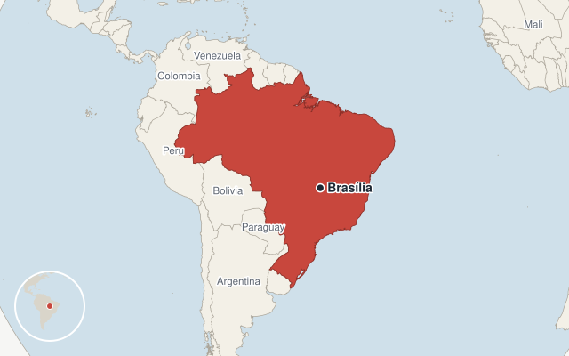

---
id    = "6df70236-cabc-5fee-b3af-3a90431afbfa"
model = "Basic"
tags  = ["south_america", "sovereign_state", "capital"]
---

## Front

What is the capital of <b>Brazil</b>?

## Back

<b>Brasília</b>

## Extra

<a href="https://en.wikipedia.org/wiki/Bras%C3%ADlia">Brasília on Wikipedia</a> <a href="https://en.wikipedia.org/wiki/Brazil">Brazil on Wikipedia</a>
