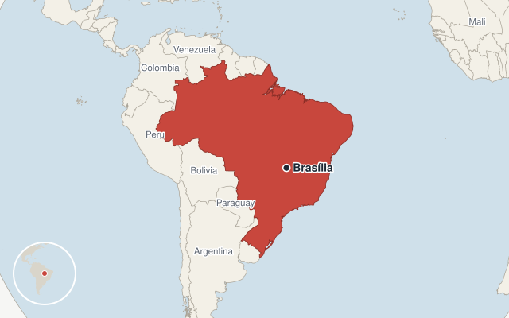

---
id    = "f2d861d5-063e-5523-b81b-3551a9e3f3fd"
model = "Basic"
tags  = ["south_america", "sovereign_state", "country"]
---

## Front

<b>Brasília</b> is the capital of which country or territory?

## Back

<b>Brazil</b>

## Extra

About 214 million people (2026), the seventh most populous country About 8.5 million km², the fifth-largest country by area

The only Portuguese-speaking country in the Americas. It contains most of the Amazon basin, with the world's largest river system and most extensive virgin tropical forest.

<a href="https://en.wikipedia.org/wiki/Brazil">Brazil on Wikipedia</a> <a href="https://en.wikipedia.org/wiki/Bras%C3%ADlia">Brasília on Wikipedia</a>
