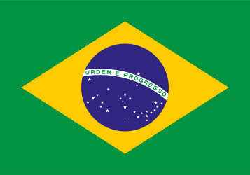
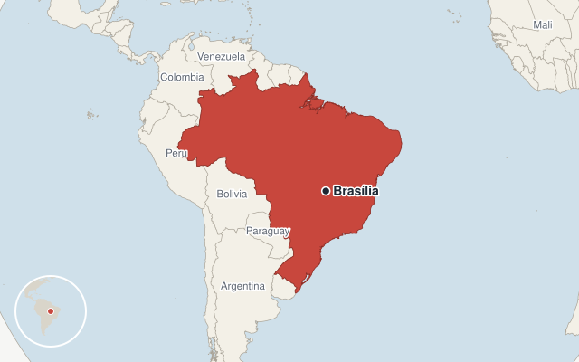

---
id    = "d1151859-f10b-5305-a573-3df21aad1683"
model = "Basic"
tags  = ["south_america", "sovereign_state", "flag"]
---

## Front

Whose flag is this?

## Back

<b>Brazil</b>

## Extra

Adopted on 19 November 1889, four days after Brazil became a republic Motto: Ordem e Progresso, "Order and Progress"

The blue disc is the sky over Rio de Janeiro on 15 November 1889, Southern Cross included. Its 27 stars stand for the 26 states and the Federal District.

<a href="https://en.wikipedia.org/wiki/Flag_of_Brazil">Flag of Brazil on Wikipedia</a> <a href="https://en.wikipedia.org/wiki/Brazil">Brazil on Wikipedia</a>
