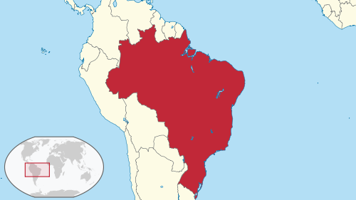
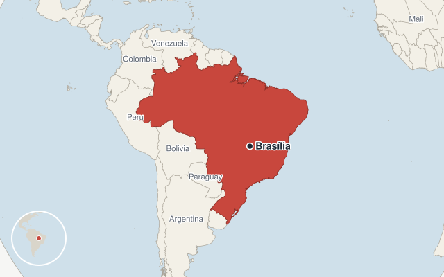
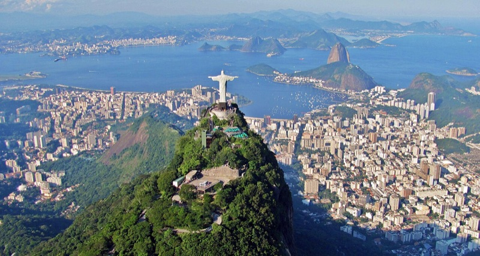

---
id    = "c1b0f0dc-c1b0-58bc-a959-3bcc9b3f9d04"
model = "Basic"
tags  = ["south_america", "sovereign_state", "map"]
---

## Front

What is highlighted on this map?

## Back

<b>Brazil</b>

## Extra

<i>Photo: Rafael Rabello de Barros, CC BY-SA 3.0, via Wikimedia Commons</i>

A coastline of 7,491 km on the Atlantic, among the longest in the world Borders every South American country except Ecuador and Chile

It covers roughly half of South America's land area, from tropical forest and wetlands to savannas, plateaus and low mountains.

<a href="https://en.wikipedia.org/wiki/Brazil">Brazil on Wikipedia</a>
