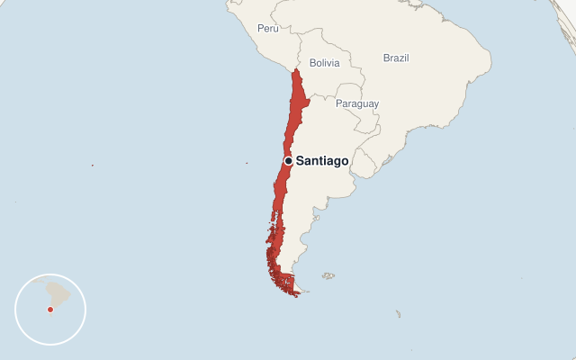

---
id    = "796d3d2d-cca0-585a-a86c-9e56ae91a617"
model = "Basic"
tags  = ["south_america", "sovereign_state", "capital"]
---

## Front

What is the capital of <b>Chile</b>?

## Back

<b>Santiago</b>

## Extra

<a href="https://en.wikipedia.org/wiki/Santiago">Santiago on Wikipedia</a> <a href="https://en.wikipedia.org/wiki/Chile">Chile on Wikipedia</a>
