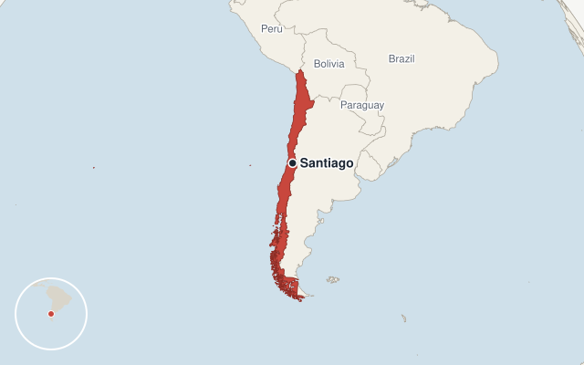

---
id    = "2b66c893-dfbf-5bd1-9ac6-be81469783d3"
model = "Basic"
tags  = ["south_america", "sovereign_state", "country"]
---

## Front

<b>Santiago</b> is the capital of which country or territory?

## Back

<b>Chile</b>

## Extra

<a href="https://en.wikipedia.org/wiki/Chile">Chile on Wikipedia</a> <a href="https://en.wikipedia.org/wiki/Santiago">Santiago on Wikipedia</a>
