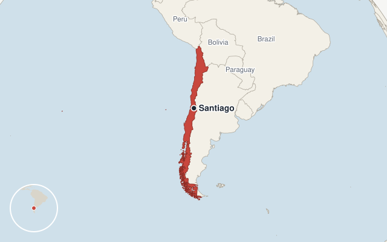

---
id    = "a5236ae9-7c17-5049-999c-434dedebe7e2"
model = "Basic"
tags  = ["south_america", "sovereign_state", "flag"]
---

## Front

Whose flag is this?

## Back

<b>Chile</b>

## Extra

Adopted on 18 October 1817

Known as La Estrella Solitaria, the Lone Star. The star is Venus to the Mapuche, blue is sky and Pacific, white the snowy Andes, and red the blood shed for independence.

<a href="https://en.wikipedia.org/wiki/Flag_of_Chile">Flag of Chile on Wikipedia</a> <a href="https://en.wikipedia.org/wiki/Chile">Chile on Wikipedia</a>
