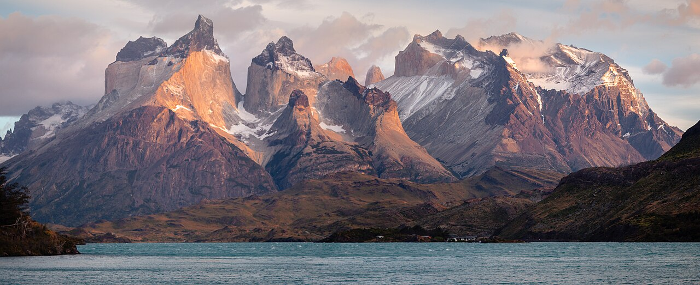

---
id    = "3754a4b1-a640-56fa-a97d-44c43ed2a202"
model = "Basic"
tags  = ["south_america", "sovereign_state", "map"]
---

## Front

What is highlighted on this map?

## Back

<b>Chile</b>

## Extra

<i>Photo: Natalia Reyes Escobar, CC BY-SA 4.0, via Wikimedia Commons</i>

Borders Peru, Bolivia and Argentina About 19.5 million people (2021) in 756,000 km²

Over 4,300 km from north to south but only 175 km wide on average, squeezed between the Andes and the Pacific. It is the country closest to Antarctica.

<a href="https://en.wikipedia.org/wiki/Chile">Chile on Wikipedia</a>
