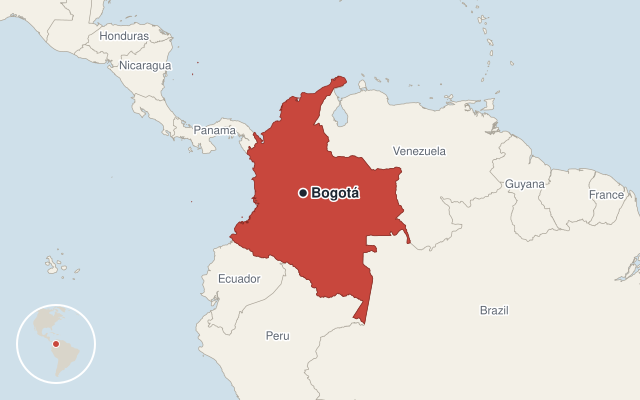

---
id    = "f7d4e20c-4f6f-5962-8cd5-76ea311fa51b"
model = "Basic"
tags  = ["south_america", "sovereign_state", "capital"]
---

## Front

What is the capital of <b>Colombia</b>?

## Back

<b>Bogotá</b>

## Extra

<a href="https://en.wikipedia.org/wiki/Bogot%C3%A1">Bogotá on Wikipedia</a> <a href="https://en.wikipedia.org/wiki/Colombia">Colombia on Wikipedia</a>
