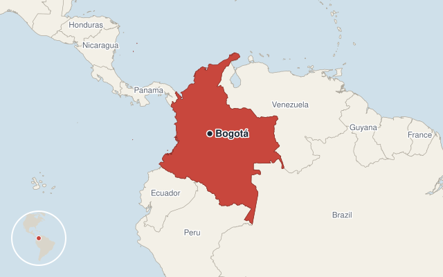

---
id    = "08a64f94-0e75-5d28-9f79-22687f376426"
model = "Basic"
tags  = ["south_america", "sovereign_state", "country"]
---

## Front

<b>Bogotá</b> is the capital of which country or territory?

## Back

<b>Colombia</b>

## Extra

<a href="https://en.wikipedia.org/wiki/Colombia">Colombia on Wikipedia</a> <a href="https://en.wikipedia.org/wiki/Bogot%C3%A1">Bogotá on Wikipedia</a>
