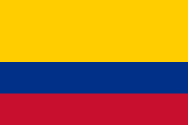

---
id    = "ad39e784-c381-5b35-ae80-0feae44c3c24"
model = "Basic"
tags  = ["south_america", "sovereign_state", "flag"]
---

## Front

Whose flag is this?

## Back

<b>Colombia</b>

## Extra

Similar flags: Ecuador (with coat of arms)
