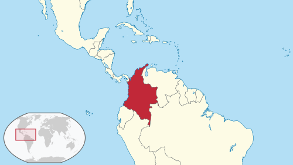
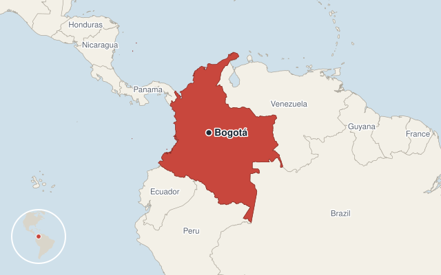

---
id    = "edfbe3f9-f2ef-5563-9636-8bfe6085eb8d"
model = "Basic"
tags  = ["south_america", "sovereign_state", "map"]
---

## Front

What is highlighted on this map?

## Back

<b>Colombia</b>

## Extra

<a href="https://en.wikipedia.org/wiki/Colombia">Colombia on Wikipedia</a>
