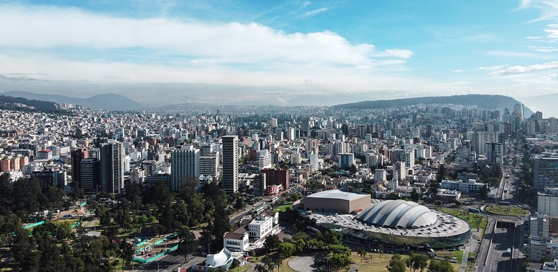

---
id    = "b8d5e9f6-ad07-59f7-afbf-019cc4a07e3a"
model = "Basic"
tags  = ["south_america", "sovereign_state", "capital"]
---

## Front

What is the capital of <b>Ecuador</b>?

## Back

<b>Quito</b>

## Extra

<i>Photo: Asamblea Nacional del Ecuador, CC BY-SA 2.0, via Wikimedia Commons</i>

About 1.76 million people (2022) 2,850 m up, in a valley on the slopes of the Pichincha volcano

Either the highest or second-highest national capital, depending on whether La Paz or Sucre counts for Bolivia. Its historic centre was among the first UNESCO World Cultural Heritage Sites, in 1978.

<a href="https://en.wikipedia.org/wiki/Quito">Quito on Wikipedia</a> <a href="https://en.wikipedia.org/wiki/Ecuador">Ecuador on Wikipedia</a>
