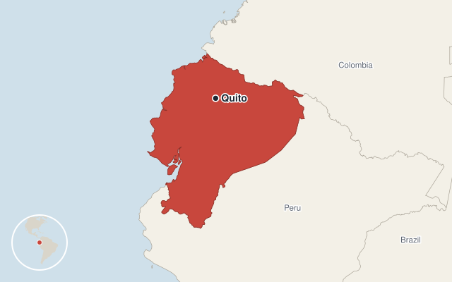

---
id    = "ac6ba65d-10c9-5587-8d14-c208715b9576"
model = "Basic"
tags  = ["south_america", "sovereign_state", "country"]
---

## Front

<b>Quito</b> is the capital of which country or territory?

## Back

<b>Ecuador</b>

## Extra

<a href="https://en.wikipedia.org/wiki/Ecuador">Ecuador on Wikipedia</a> <a href="https://en.wikipedia.org/wiki/Quito">Quito on Wikipedia</a>
