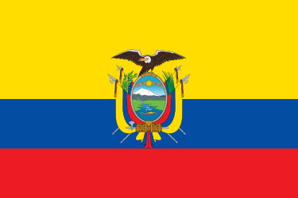
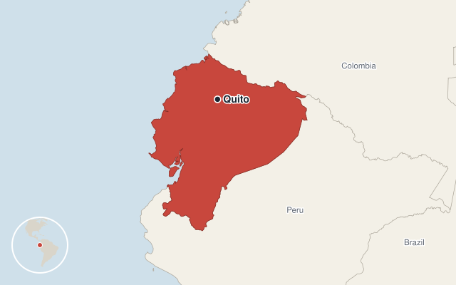

---
id    = "1e37a33d-a2d5-5c37-b90f-f13f27f0a3a3"
model = "Basic"
tags  = ["south_america", "sovereign_state", "flag"]
---

## Front

Whose flag is this?

## Back

<b>Ecuador</b>

## Extra

Similar flags: Colombia (no coat of arms)

<a href="https://en.wikipedia.org/wiki/Flag_of_Ecuador">Flag of Ecuador on Wikipedia</a> <a href="https://en.wikipedia.org/wiki/Ecuador">Ecuador on Wikipedia</a>
