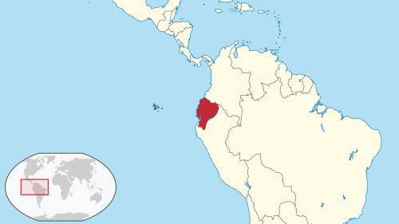
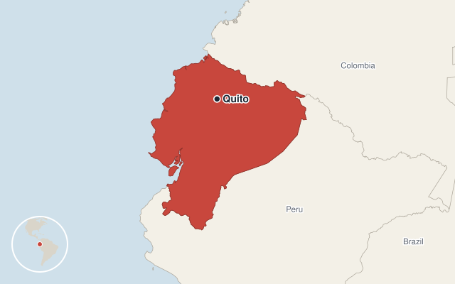

---
id    = "c807a649-1d39-5d5d-8a05-8fc405f068cb"
model = "Basic"
tags  = ["south_america", "sovereign_state", "map"]
---

## Front

What is highlighted on this map?

## Back

<b>Ecuador</b>

## Extra

<a href="https://en.wikipedia.org/wiki/Ecuador">Ecuador on Wikipedia</a>
