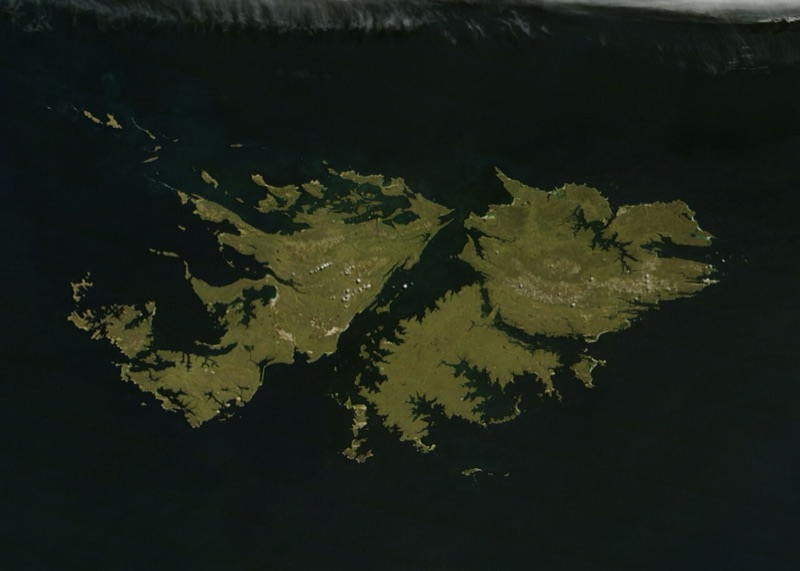

---
id    = "d158d365-67d9-5a96-a914-6a0ee4da26c8"
model = "Basic"
tags  = ["south_america", "map"]
---

## Front

What is highlighted on this map?

## Back

<b>Falkland Islands</b>

## Extra

<i>Photo: NASA, Public domain, via Wikimedia Commons</i>

East Falkland, West Falkland and 776 smaller islands About 500 km east of South America's Patagonian coast

The capital and largest settlement, Stanley, is on East Falkland. Both major islands have mountain ranges reaching about 700 m.

Overseas territory of the United Kingdom.

<a href="https://en.wikipedia.org/wiki/Falkland_Islands">Falkland Islands on Wikipedia</a>
