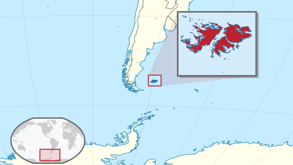

---
id    = "d158d365-67d9-5a96-a914-6a0ee4da26c8"
model = "Basic"
tags  = ["south_america", "map"]
---

## Front

What is highlighted on this map?

## Back

<b>Falkland Islands</b>

## Extra

Overseas territory of the United Kingdom.

<a href="https://en.wikipedia.org/wiki/Falkland_Islands">Falkland Islands on Wikipedia</a>
