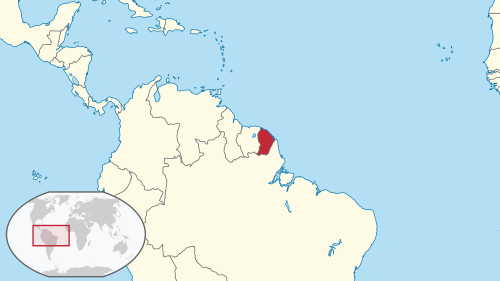

---
id    = "260fce4a-f49f-5418-952a-aac1d7d65fac"
model = "Basic"
tags  = ["south_america", "map"]
---

## Front

What is highlighted on this map?

## Back

<b>French Guiana</b>

## Extra

Overseas department of France.

<a href="https://en.wikipedia.org/wiki/French_Guiana">French Guiana on Wikipedia</a>
