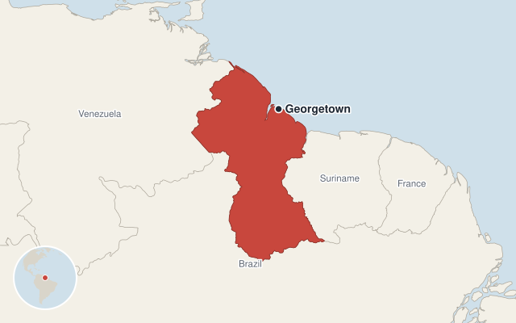

---
id    = "9f510912-cf5d-5d56-a230-a3a51fdc7745"
model = "Basic"
tags  = ["south_america", "sovereign_state", "capital"]
---

## Front

What is the capital of <b>Guyana</b>?

## Back

<b>Georgetown</b>

## Extra

<a href="https://en.wikipedia.org/wiki/Georgetown,_Guyana">Georgetown, Guyana on Wikipedia</a> <a href="https://en.wikipedia.org/wiki/Guyana">Guyana on Wikipedia</a>
