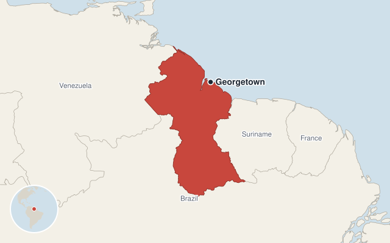

---
id    = "26866bf8-e8ae-53bc-8608-c9cf842620f1"
model = "Basic"
tags  = ["south_america", "sovereign_state", "country"]
---

## Front

<b>Georgetown</b> is the capital of which country or territory?

## Back

<b>Guyana</b>

## Extra

<a href="https://en.wikipedia.org/wiki/Guyana">Guyana on Wikipedia</a> <a href="https://en.wikipedia.org/wiki/Georgetown,_Guyana">Georgetown, Guyana on Wikipedia</a>
