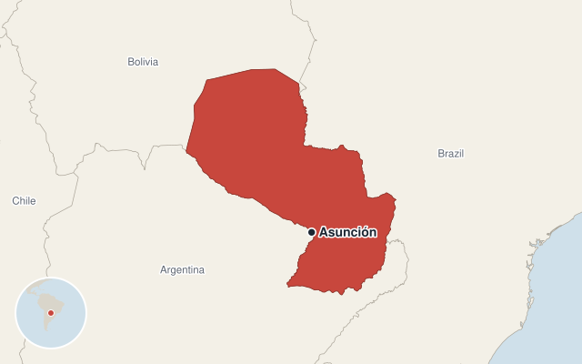

---
id    = "e05d6c75-6c10-59c4-aaef-b49a678f4ebe"
model = "Basic"
tags  = ["south_america", "sovereign_state", "capital"]
---

## Front

What is the capital of <b>Paraguay</b>?

## Back

<b>Asunción</b>

## Extra

<a href="https://en.wikipedia.org/wiki/Asunci%C3%B3n">Asunción on Wikipedia</a> <a href="https://en.wikipedia.org/wiki/Paraguay">Paraguay on Wikipedia</a>
