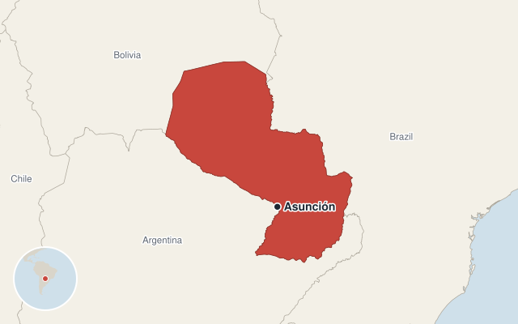

---
id    = "953dfe33-188f-5a16-8dcf-82014ce9a595"
model = "Basic"
tags  = ["south_america", "sovereign_state", "country"]
---

## Front

<b>Asunción</b> is the capital of which country or territory?

## Back

<b>Paraguay</b>

## Extra

About 6.8 million people (2017) on 406,756 km² The Itaipu Dam on the Brazilian border is the third-largest hydroelectric dam in the world

More than 90% of people speak Guarani alongside Spanish, the highest rate of fluency in an indigenous language in Latin America.

<a href="https://en.wikipedia.org/wiki/Paraguay">Paraguay on Wikipedia</a> <a href="https://en.wikipedia.org/wiki/Asunci%C3%B3n">Asunción on Wikipedia</a>
