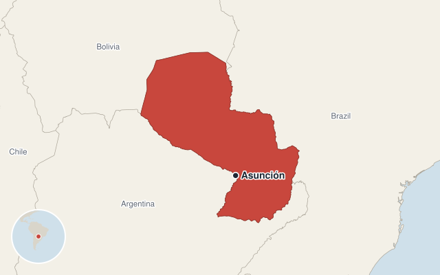

---
id    = "1dadd36a-ba46-5bf7-bdde-0aa6e9c3da08"
model = "Basic"
tags  = ["south_america", "sovereign_state", "flag"]
---

## Front

Whose flag is this?

## Back

<b>Paraguay</b>

## Extra

<a href="https://en.wikipedia.org/wiki/Flag_of_Paraguay">Flag of Paraguay on Wikipedia</a> <a href="https://en.wikipedia.org/wiki/Paraguay">Paraguay on Wikipedia</a>
