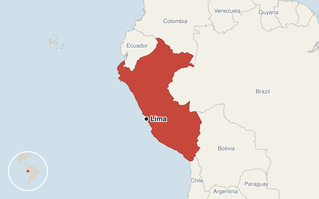
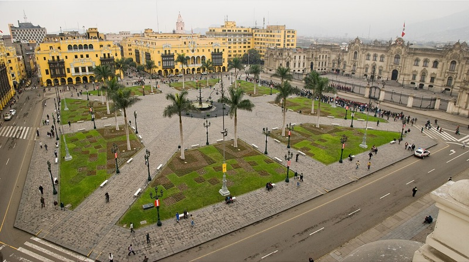

---
id    = "6e3acd13-0a61-5edc-9065-86506ce08ab1"
model = "Basic"
tags  = ["south_america", "sovereign_state", "capital"]
---

## Front

What is the capital of <b>Peru</b>?

## Back

<b>Lima</b>

## Extra

<i>Photo: JulioKuLu, CC BY-SA 4.0, via Wikimedia Commons</i>

About 9.9 million people (2022) In the desert of the central coast, overlooking the Pacific Ocean

The name comes from Limaq, an oracle in the Rímac Valley that means "talker" or "speaker" in coastal Quechua. The Spanish replaced the oracle with a church, but the name stayed.

<a href="https://en.wikipedia.org/wiki/Lima">Lima on Wikipedia</a> <a href="https://en.wikipedia.org/wiki/Peru">Peru on Wikipedia</a>
