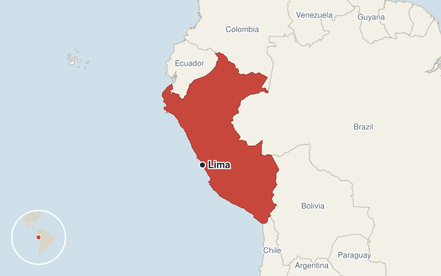

---
id    = "1047cc1a-fd4c-5d38-9b26-ee216d895ea1"
model = "Basic"
tags  = ["south_america", "sovereign_state", "country"]
---

## Front

<b>Lima</b> is the capital of which country or territory?

## Back

<b>Peru</b>

## Extra

About 34 million people (2025) on 1,285,216 km²

Its heritage goes back to the Caral-Supe civilization, the earliest in the Americas. The Inca Empire was the largest known state in the pre-Columbian Americas.

<a href="https://en.wikipedia.org/wiki/Peru">Peru on Wikipedia</a> <a href="https://en.wikipedia.org/wiki/Lima">Lima on Wikipedia</a>
