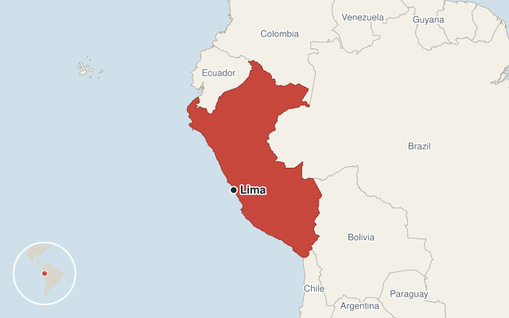

---
id    = "f8e2e348-1133-53e0-8bd4-41fb55755e83"
model = "Basic"
tags  = ["south_america", "sovereign_state", "flag"]
---

## Front

Whose flag is this?

## Back

<b>Peru</b>

## Extra

<a href="https://en.wikipedia.org/wiki/Flag_of_Peru">Flag of Peru on Wikipedia</a> <a href="https://en.wikipedia.org/wiki/Peru">Peru on Wikipedia</a>
