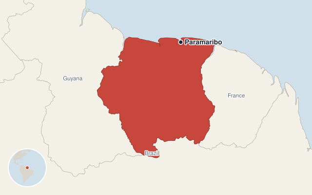
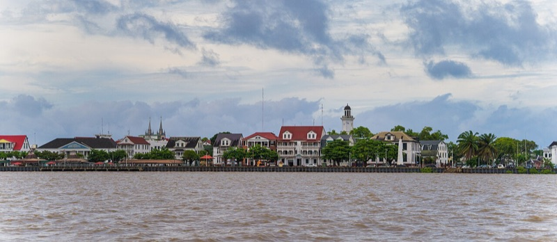

---
id    = "a967fd6f-0840-5821-a755-718923fb5e50"
model = "Basic"
tags  = ["south_america", "sovereign_state", "capital"]
---

## Front

What is the capital of <b>Suriname</b>?

## Back

<b>Paramaribo</b>

## Extra

<i>Photo: Rafaeljantz, CC BY-SA 4.0, via Wikimedia Commons</i>

About 252,600 people (2025 estimate), almost half the country On the banks of the Suriname River

Named for the Paramaribo people at the river's mouth, from Tupi-Guarani words for "large river" and "inhabitants". Its historic inner city has been a UNESCO World Heritage Site since 2002.

<a href="https://en.wikipedia.org/wiki/Paramaribo">Paramaribo on Wikipedia</a> <a href="https://en.wikipedia.org/wiki/Suriname">Suriname on Wikipedia</a>
