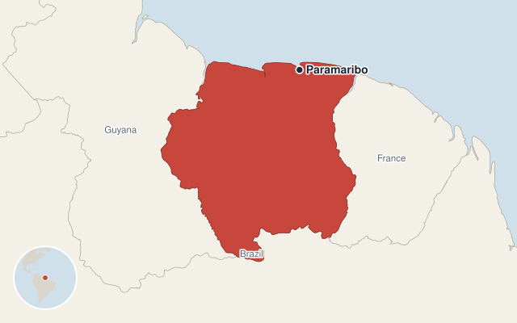

---
id    = "9b0c3933-042a-5b16-88c6-2ed5406a1058"
model = "Basic"
tags  = ["south_america", "sovereign_state", "country"]
---

## Front

<b>Paramaribo</b> is the capital of which country or territory?

## Back

<b>Suriname</b>

## Extra

About 613,000 people (2021) in about 165,940 km² The smallest sovereign country in South America by population and territory

Over 95% of its land is rainforest, the second-highest proportion of forest cover in the world.

<a href="https://en.wikipedia.org/wiki/Suriname">Suriname on Wikipedia</a> <a href="https://en.wikipedia.org/wiki/Paramaribo">Paramaribo on Wikipedia</a>
