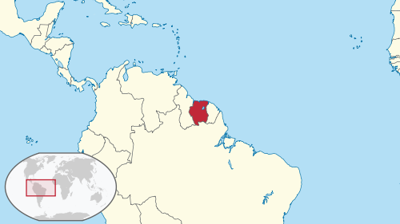
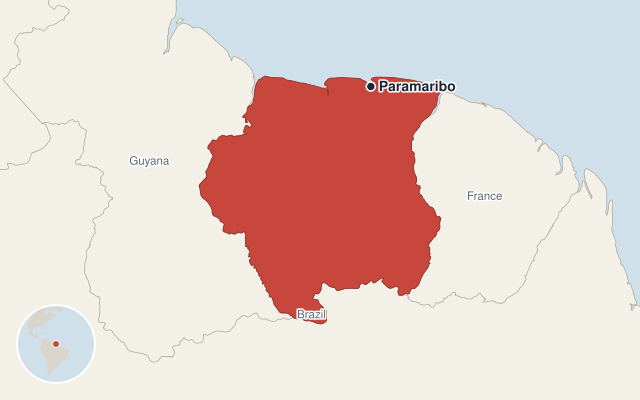

---
id    = "e64c5d6d-2812-593f-a2ec-6978297af5ed"
model = "Basic"
tags  = ["south_america", "sovereign_state", "map"]
---

## Front

What is highlighted on this map?

## Back

<b>Suriname</b>

## Extra

<a href="https://en.wikipedia.org/wiki/Suriname">Suriname on Wikipedia</a>
