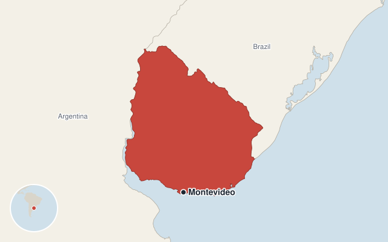

---
id    = "d02218e0-8a45-5fb6-a41d-a47a023797f2"
model = "Basic"
tags  = ["south_america", "sovereign_state", "capital"]
---

## Front

What is the capital of <b>Uruguay</b>?

## Back

<b>Montevideo</b>

## Extra

About 1.29 million people in the city proper (2023 census) On the northeastern bank of the Río de la Plata

A Portuguese garrison was set up here in 1723 and expelled by the Spanish soldier Bruno Mauricio de Zabala in 1724. The city hosts Mercosur's headquarters.

<a href="https://en.wikipedia.org/wiki/Montevideo">Montevideo on Wikipedia</a> <a href="https://en.wikipedia.org/wiki/Uruguay">Uruguay on Wikipedia</a>
