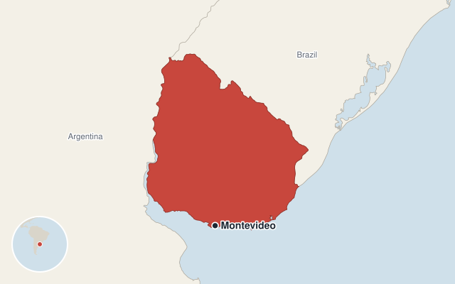

---
id    = "d3ad10b9-8d9d-5e4d-9119-ad7828fe27c4"
model = "Basic"
tags  = ["south_america", "sovereign_state", "country"]
---

## Front

<b>Montevideo</b> is the capital of which country or territory?

## Back

<b>Uruguay</b>

## Extra

<a href="https://en.wikipedia.org/wiki/Uruguay">Uruguay on Wikipedia</a> <a href="https://en.wikipedia.org/wiki/Montevideo">Montevideo on Wikipedia</a>
