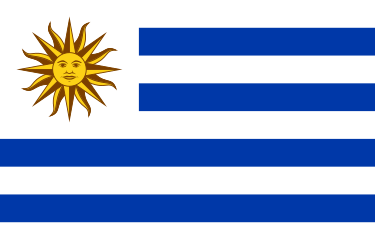
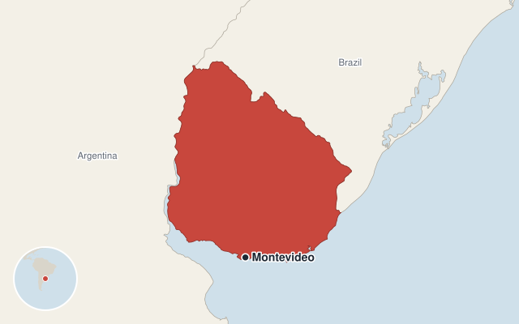

---
id    = "c05b34ce-5f20-5941-8cd4-ec86d0468a46"
model = "Basic"
tags  = ["south_america", "sovereign_state", "flag"]
---

## Front

Whose flag is this?

## Back

<b>Uruguay</b>

## Extra

First adopted by law on 18 December 1828, with 19 stripes until 1830

Nine stripes stand for the nine original departments, modelled on the US flag. The golden Sun of May, with 16 rays, represents the May Revolution of 1810.

<a href="https://en.wikipedia.org/wiki/Flag_of_Uruguay">Flag of Uruguay on Wikipedia</a> <a href="https://en.wikipedia.org/wiki/Uruguay">Uruguay on Wikipedia</a>
