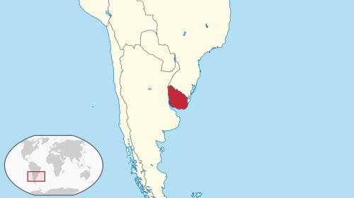
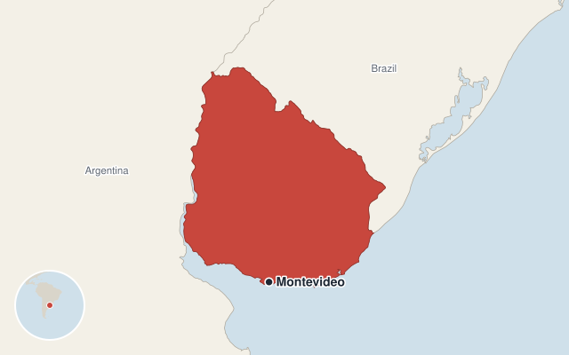

---
id    = "311a862f-72d2-5e4a-9041-4c6fa7c6af55"
model = "Basic"
tags  = ["south_america", "sovereign_state", "map"]
---

## Front

What is highlighted on this map?

## Back

<b>Uruguay</b>

## Extra

Borders Argentina to the west and Brazil to the north 176,215 km² of land

Mostly rolling plains and low hill ranges called cuchillas, with a fertile coastal lowland. The Río de la Plata lies to the south and the Atlantic to the southeast.

<a href="https://en.wikipedia.org/wiki/Uruguay">Uruguay on Wikipedia</a>
