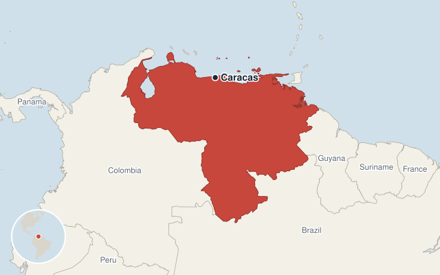

---
id    = "8615091a-6697-5428-b4cf-a3e597a9e5f3"
model = "Basic"
tags  = ["south_america", "sovereign_state", "capital"]
---

## Front

What is the capital of <b>Venezuela</b>?

## Back

<b>Caracas</b>

## Extra

<a href="https://en.wikipedia.org/wiki/Caracas">Caracas on Wikipedia</a> <a href="https://en.wikipedia.org/wiki/Venezuela">Venezuela on Wikipedia</a>
