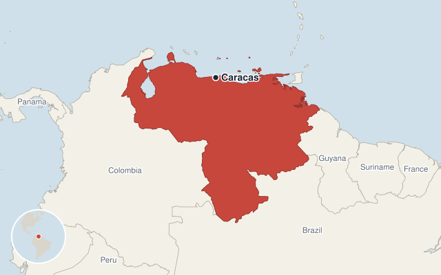

---
id    = "1a876ac4-e924-5e10-b225-170ab4b4ca91"
model = "Basic"
tags  = ["south_america", "sovereign_state", "country"]
---

## Front

<b>Caracas</b> is the capital of which country or territory?

## Back

<b>Venezuela</b>

## Extra

<a href="https://en.wikipedia.org/wiki/Venezuela">Venezuela on Wikipedia</a> <a href="https://en.wikipedia.org/wiki/Caracas">Caracas on Wikipedia</a>
