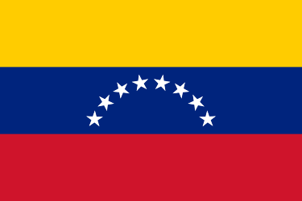

---
id    = "d2e094e7-e9d6-59b6-a76c-3e19c43811e3"
model = "Basic"
tags  = ["south_america", "sovereign_state", "flag"]
---

## Front

Whose flag is this?

## Back

<b>Venezuela</b>

## Extra

<a href="https://en.wikipedia.org/wiki/Flag_of_Venezuela">Flag of Venezuela on Wikipedia</a> <a href="https://en.wikipedia.org/wiki/Venezuela">Venezuela on Wikipedia</a>
