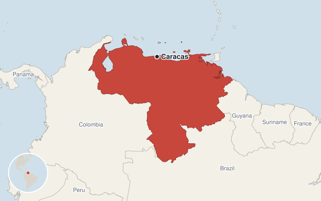

---
id    = "d2e094e7-e9d6-59b6-a76c-3e19c43811e3"
model = "Basic"
tags  = ["south_america", "sovereign_state", "flag"]
---

## Front

Whose flag is this?

## Back

<b>Venezuela</b>

## Extra

Current version introduced in 2006

The yellow, blue and red tricolour dates to 1811. It follows Francisco de Miranda's design for his 1806 expedition, which also inspired the flags of Colombia and Ecuador.

<a href="https://en.wikipedia.org/wiki/Flag_of_Venezuela">Flag of Venezuela on Wikipedia</a> <a href="https://en.wikipedia.org/wiki/Venezuela">Venezuela on Wikipedia</a>
