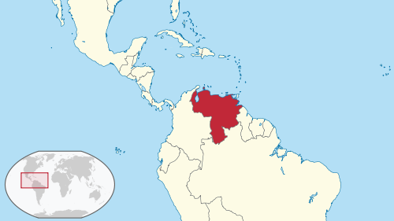
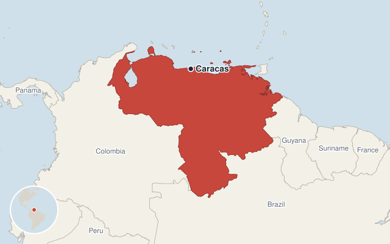
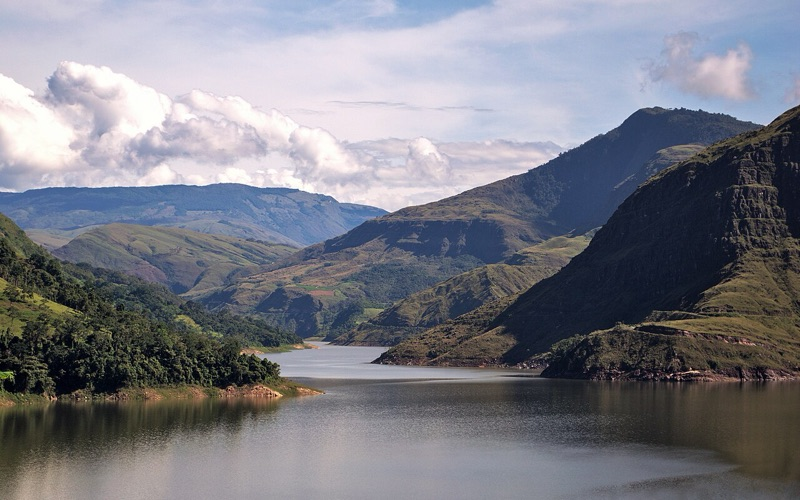

---
id    = "fd3ed4d5-6b69-5ed5-8276-8673e5245ae3"
model = "Basic"
tags  = ["south_america", "sovereign_state", "map"]
---

## Front

What is highlighted on this map?

## Back

<b>Venezuela</b>

## Extra

<i>Photo: Davevzla, CC BY-SA 4.0, via Wikimedia Commons</i>

Neighbours: Colombia, Brazil and Guyana The Caribbean Sea and Atlantic Ocean lie to the north

A continental landmass plus various islands and islets in the Caribbean Sea.

<a href="https://en.wikipedia.org/wiki/Venezuela">Venezuela on Wikipedia</a>
